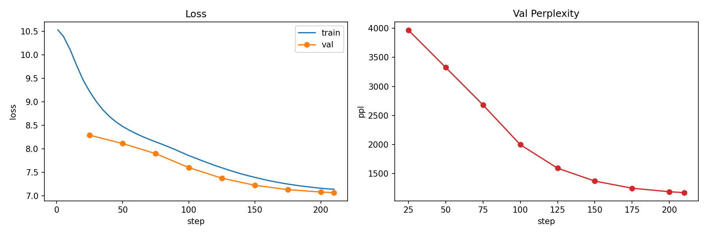
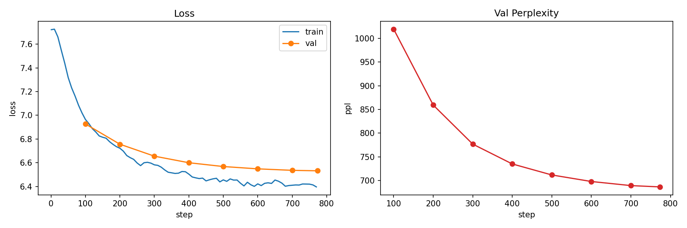
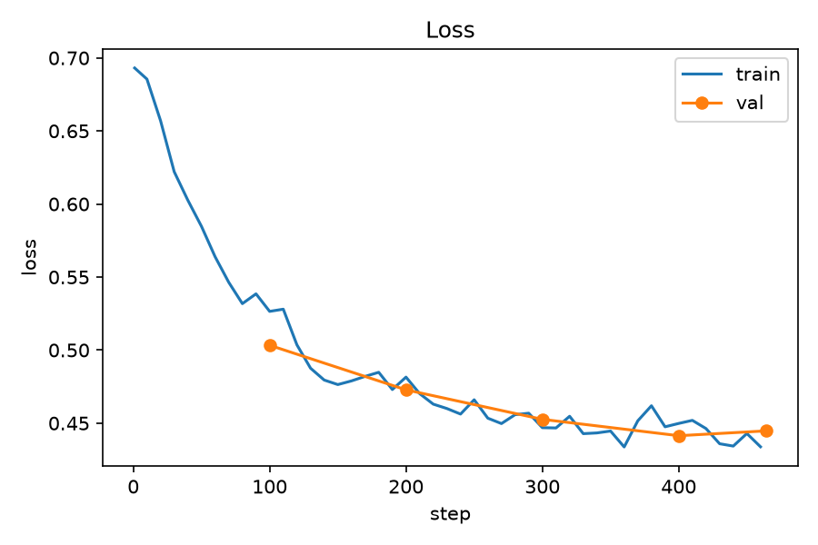

# 实际效果
> 自制中文 LLM（~109.5M）端到端实际效果记录。生成时间 2026-10-05，全部输出为真实模型生成，未经人工挑选或修改。

# 模型概览
| 项 | 值 |
|---|---|
| 架构 | Llama 结构（RMSNorm + SwiGLU + RoPE，decoder-only，MHA） |
| 参数量 | ~109.5M（embedding 24.6M + 12 层 × 7.1M，权重共享） |
| 词表 | 32k BPE（sentencepiece，byte_fallback，含 4 个特殊 token） |
| 上下文长度 | 1024 |
| 训练流程 | 预训练 → SFT → DPO（详见 docs/01~08） |

# 训练指标总览
| 阶段 | 训练数据 | 规模 | 关键超参 | 最终指标 |
|---|---|---|---|---|
| 预训练 | SkyPile 中文语料 | 2107 步 × 262,144 token/步 ≈ **5.5 亿 token**（1 epoch） | lr 6e-4 cosine，bf16，4070 Ti | 语料尾部 ppl **59.78**（模块 7 实测） |
| SFT | Firefly 指令数据 | 10 万条采样式，773 步 × 128 条/步 | lr 2e-5 cosine，loss 只算回答，22~27 分钟 | val ppl **56.18** |
| DPO | COIG-P 偏好对 | 29,700 对，464 步 × 64 对/步 | β=0.1，lr 5e-7，41 分钟 | **val_reward_acc 0.5→0.80**，val_loss 0.693→0.445 |

附注：`logs/pretrain_log.jsonl` 仅存前 210 步记录（train_loss 10.52→7.14），完整训练步数以 ckpt 内记录（step=2107）为准。

# 训练曲线
预训练 loss/ppl（日志前 210 步）：

SFT loss/ppl：

DPO loss / reward_acc（核心指标 val_reward_acc 从 0.5 升至 0.80）：

# 客观评测（模块 7，Windows/4070 实测）
| 评测 | sft.ckpt | dpo.ckpt | 说明 |
|---|---|---|---|
| C-Eval val 800 题 | 25.50% | 26.37% | 随机线 25%，100M 模型基本贴随机线属预期 |
| ppl（sft_val 回答） | 79.62 | 80.06 | dpo 略高符合"牺牲似然换偏好"预期 |
| case 对照复读率（12 题） | 0/12 | 0/12 | 采样解码 + 复读缓解下机械复读被消除 |

# 生成效果（50 demo）
**生成配置**：`checkpoints/dpo.ckpt`，采样解码 temperature=0.7、top_p=0.9、repetition_penalty=1.1、no_repeat_ngram=3，max_new_tokens=100，seed=42。提问模板 `<bos>用户：{Q}\n助手：`。

## 日常与身份
| # | 问题 | 模型回答 |
|---|---|---|
| 1 | 你好 | 很抱歉，我不是对你做任何事，而是因为你的想法和行为不能做出决定。 |
| 2 | 在吗 | 题目：余生堂,李咏如,李元庆,李天寿,许冠文,曾志 |
| 3 | 谢谢你 | 很抱歉，我无法回答这个问题。但可以为您解答。 |
| 4 | 你会做什么 | 很抱歉，我不是想逃避而已。 　」你们别无他见。你说什么？今天你也出去玩了。上次他离开了我，我就回去了。” べ『 |
| 5 | 今天天气不错 | 明天，阳光明媚，景色宜人。 |
| 6 | 你是谁 | 站在一个边远的地方，你却像个大石头，这石头在走着，那块石头上刻着你的名字。 |
| 7 | 你叫什么名字 | 名字：无敌,你叫冷漠,我叫冷屑,我叫做冷漠 |
| 8 | 你是人工智能吗 | 人工智能：AI（人脑）是将计算机系统、自然语言处理算法和计算机技术进行集成，通过模拟人类智能来构建人类大脑。 |
| 9 | 你能思考吗 | 答案是：一言九宫寒。 成语出处：《宋史·天官传》命案名嘉靖，僭才子直卒，且非名贵人也。” |

## 常识与地理历史
| # | 问题 | 模型回答 |
|---|---|---|
| 10 | 天空为什么是蓝色的 | 秋天的时候，美丽的景色和美丽的风景都映衬着大地。 |
| 11 | 水的沸点是多少度 | 沸点越高，沸点越低。 |
| 12 | 一年有多少天 | 很抱歉，我无法回答这个问题。 |
| 13 | 地球是什么形状的 | 地球是灰色星球，其体积是太阳的1/4，它的直径是地球的2/3。 |
| 14 | 月亮本身会发光吗 | 太阳是微小的，星球的辐射能量很高。 |
| 15 | 中国的首都是哪里 | 外国的第一是卢浮宫。 |
| 16 | 长江有多长 | 长江是长江，是中国的黄河。 |
| 17 | 中国古代四大发明是什么 | 指发明发明或者实用新型。 成语出处：《史记·高公孙丁传》其名曰"子孙三帝"…… |
| 18 | 唐朝是哪个朝代之后的 | 闭关前，唐朝帝国由各朝领主组成的。 |

## 生活健康
| # | 问题 | 模型回答 |
|---|---|---|
| 19 | 失眠了怎么办 | 吃药，喝冰镇酒，先喝饮料。 |
| 20 | 感冒了应该注意什么 | 感冒的时候，身体里就有一些感染病毒的细菌……（因果循环的废话） |
| 21 | 怎么减肥比较健康 | 减肥的方法有哪些，有以下几种：1. 坚持运动，比如散步、慢跑、游泳等。2. 保持合理的饮食结构…… |
| 22 | 推荐一道家常菜 | 1、将鸡翅、火腿、青椒、番茄酱、土豆、胡萝卜、青蒜和盐、胡椒粉和盐调味。2、将熟好的鸡翅放入锅中…… |

## 数学推理
| # | 问题 | 模型回答 |
|---|---|---|
| 23 | 1+1等于几 | 三个数的数字，等于一个数。 |
| 24 | 3乘以7等于多少 | 答案是：12。 |
| 25 | 小明有3个苹果，吃了1个，还剩几个 | 小明有4个苹果。 |
| 26 | 100减37等于多少 | 100减5个字。 |

## 写作与翻译
| # | 问题 | 模型回答 |
|---|---|---|
| 27 | 写一句关于春天的诗 | 霜雨中，落日凉意。秋风轻拂翠梢，秋风吹动翠影。……（写的是秋天） |
| 28 | 帮我写一句新年祝福语 | 春节祝福记忆犹存。元旦祝愿寿星们新年快乐，团聚团圆。 |
| 29 | 写一条周末朋友圈文案 | 很抱歉，我无法回答这个问题…… |
| 30 | 把'我爱中国'翻译成英文 | "In the find is a world of First as been up how to doesn't be show..."（无效英文） |
| 31 | 把'今天天气很好'翻译成英文 | The divid is a made in the people standing for big smalls.（无效英文） |

## 编程
| # | 问题 | 模型回答 |
|---|---|---|
| 32 | 用Python写一个hello world | Python是一个简单的Java语言模型，通过学习Python中的动态数据并输出相应的代码。 |
| 33 | 什么是递归 | 递归是一种货币，包含着重复的递归……（通篇跑题） |

## 开放问答
| # | 问题 | 模型回答 |
|---|---|---|
| 34 | 推荐一本好看的书 | 《老子》是陈柏霖的《论语》。…… |
| 35 | 周末去哪里玩比较好 | 周末去哪儿玩好吗？ |
| 36 | 阅读有什么好处 | 利他无敌，何妨害人。 成语出处：《古语·阳平易》…… |
| 37 | 讲一个短笑话 | 题目：我为什么这样说——我和妹妹叫了。……（有叙事雏形但不构成笑话） |
| 38 | 你觉得人工智能会取代人类吗 | 人工智能指的是计算机、智能手机和平板电脑等工具……（定义式回答，文不对题但语句通顺） |
| 39 | 怎样才能变得更自律 | 自律，我会用更自律的思维来解决问题。 |
| 40 | 钱能买到幸福吗 | 钱能买一送三餐。 |
| 41 | 如何学习一门新语言 | 1. 练习新语言：掌握新语言（如词汇、语法和词汇）……（有列表结构，内容空泛） |
| 42 | 每天喝咖啡对身体好吗 | 1. 喝咖啡，因为咖啡因会刺激神经，导致睡眠不足。……（第 1 点合理，后面跑题） |
| 43 | 什么是区块链 | 区块链是一种区块链技术……它是一种基于计算机技术的分布式账本技术。（开头同义反复，后半句接近正解） |
| 44 | 太阳系有几大行星 | 1. 太阳系中可能有三个行星，分别是太阳、太阳和地球。 |
| 45 | 秦始皇是谁 | 秦始皇兵刃之极，抱极身亡。 |
| 46 | 怎么学好数学 | 数学是一种数学，它是一个用来量化的学习方法…… |
| 47 | 跑步有什么好处 | 健身可以增加肌肉力量，提高心肺功能。（正确） |
| 48 | 帮我起一个网名 | 很抱歉，我只是想出个站出来。建议您写信给你。 |
| 49 | 什么是量子力学 | 量子力学是指量子级、二元几何等物理现象……（术语堆砌，无实际内容） |
| 50 | 如何给手机省电 | 很抱歉，我无法回答这个问题。 |

# 结论（按回答质量分档统计）
| 档位 | 数量 | 典型 |
|---|---|---|
| 基本可用（事实正确或结构合理） | ~8 | #21 减肥、#22 家常菜、#28 祝福、#38 AI 定义、#41 学语言、#42 咖啡、#43 区块链、#47 跑步 |
| 语句通顺但内容错误/跑题 | ~30 | #15 首都答"卢浮宫"、#24 3×7=12、#13 地球形状 |
| 复读/无效输出（"很抱歉"、乱码、同义反复） | ~12 | #4、#12、#29、#30、#31、#48、#50 等 |

# 已知短板（与 docs/06/07/08 结论一致）
1. **事实性问题不可靠**——100M 参数 + 5.5 亿 token 语料，知识容量有限，常见事实错误（首都、朝代、行星数）
2. **数学与逻辑基本不可用**——四则运算全错，100M 规模下的预期表现
3. **英文几乎无能力**——预训练语料为中文，翻译任务输出无效英文
4. **身份/元问题无概念**——训练语料无身份定义，"你是谁"类问题得到散文式续写
5. **复读已被解码策略控制，但内容质量受基座限制**——机械复读 0/12，空泛/跑题是模型能力问题，非解码问题
